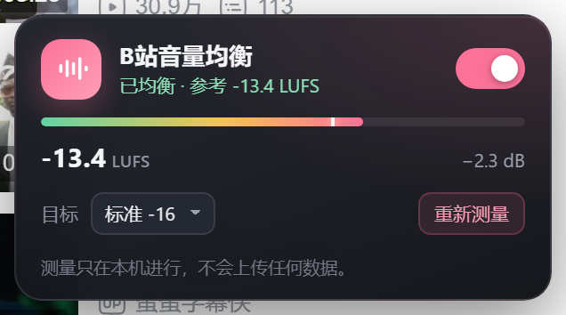

# B站音量均衡器

一个 Chrome / Edge 扩展：自动测量 B 站网页视频的响度，把「这个 UP 主声音特别小、那个 UP 主声音特别大」拉回到同一水平。

它不是简单地把音量调大，而是按 **EBU R128 / ITU-R BS.1770** 测量视频的整体响度（LUFS），再施加一个整体增益，并用限幅器保护峰值。这样不会把视频本身的动态范围压扁。



> 当前版本：`0.1.0`，面向桌面版 Chromium 浏览器的 B 站网页播放器。B 站 App、手机浏览器、番剧 DRM 内容暂不支持。
>
> 这是一个非官方项目，与哔哩哔哩无隶属关系。「B站 / 哔哩哔哩 / Bilibili」等名称和页面元素的权利归其权利人所有；本项目不下载、不修改、不重新分发 B 站内容。文档截图仅用于说明扩展功能。

---

## 安装

不需要编译，直接加载文件夹。

### Edge

1. 打开 `edge://extensions/`
2. 打开左下角「开发人员模式」
3. 点击「加载解压缩的扩展」
4. 选择本目录 `bilibili-volume-balancer`
5. 打开任意 B 站视频页，例如 `https://www.bilibili.com/video/BV...`
6. **在页面上点一下**（浏览器的自动播放策略要求一次用户手势），右下角会出现控制面板

### Chrome

步骤相同，地址换成 `chrome://extensions/`，同样开启「开发者模式」→「加载已解压的扩展程序」。

安装后如果面板没有出现，刷新一次视频页。

---

## 使用

面板在播放器右下角：

- **开关**：关闭后完全不改动声音，但仍会继续测量。
- **目标响度**：
  - `夜间 -20`：整体更轻，适合深夜
  - `偏轻 -18`
  - `标准 -16`：默认，接近大多数网络视频的常见水平
  - `偏响 -14`
- **读数**：当前视频的参考响度（LUFS）和正在施加的增益（dB）。
- **重新测量**：清空当前视频的测量历史，重新开始；不会删除历史缓存。

首次打开一个视频时，会先测量约 3 秒再开始校正；约 6 秒后会用更完整的 integrated loudness 再精调一次。之后每个视频、每位 UP 主的测量结果会缓存在本机，下次打开可以直接套用，再在后台慢慢修正。

B 站自己的音量条仍然有效。扩展会把 `video.volume` 的影响从测量里扣掉，所以你调小 B 站音量时，它不会反过来把声音补回去。

---

## 界面怎么看


从上到下：

| 区域 | 含义 |
|---|---|
| 左上角状态文字 | 当前在做什么。`已均衡 · 参考 -13.4 LUFS` 表示已经接管并稳定；`测量中 · 1.4 秒` 表示还在收集样本；`点击页面空白处启用` 表示浏览器还没拿到用户手势；`视频已静音` 表示 B 站播放器处于静音状态。 |
| 右上角开关 | 粉色是开启，灰色是关闭。关闭后不施加任何增益，但测量和缓存仍会继续。 |
| 中间彩色条 | 当前视频响度在 `-40 … 0 LUFS` 里的位置。绿色偏轻，粉色偏响；白色竖线是目标位置（默认 `-16 LUFS`）。填充在竖线左边说明视频偏轻、会被提升；在右边说明偏响、会被衰减。 |
| 左侧大数字 | 当前视频的参考响度，单位 LUFS。数字越小越轻：`-30` 很轻，`-10` 很响。扩展会把大多数视频拉向目标值。 |
| 右侧 dB | 扩展实际施加的增益。`+` 是提升，`−` 是衰减。例如视频 `-13.4 LUFS`、目标 `-16 LUFS`，就应该衰减约 `-2.6 dB`。 |
| 目标下拉框 | `夜间 -20` 最轻，`偏轻 -18`，`标准 -16` 默认，`偏响 -14`。切换后会立即按新目标重算增益。 |
| 重新测量 | 清空当前视频的测量历史，增益先回到 `0 dB`，几秒后重新校正。不会删除已经保存的历史缓存。 |
| 底部小字 | 当前状态说明，例如“测量只在本机进行”或“已按这位 UP 主的历史响度校准”。 |

读数的直觉解释：

- **两个数字不是一回事**：左边 `LUFS` 是“这个视频本身有多响”，右边 `dB` 是“插件帮它补/减了多少”。
- **目标线在中间偏右**：`-16 LUFS` 是默认目标，白色竖线大约在进度条的 60% 位置。
- **增益到顶**：如果右边显示 `+15.0 dB`，但视频仍然偏轻，说明已经到达提升上限，避免把底噪放大。
- **增益为 0**：说明视频本身的响度已经接近目标，不需要处理。
- **前几秒**：刚打开视频时显示“测量中”，这是正常的；约 3 秒开始校正，约 6 秒后更稳定。

常见状态：

| 状态 | 意思 / 怎么办 |
|---|---|
| `点击页面空白处启用` | 浏览器自动播放策略挂起了音频上下文，在页面上点一下即可。 |
| `等待视频播放` | 还没找到主播放器，等页面加载或刷新。 |
| `测量中 · X 秒` | 正在收集响度样本，先不要以这个读数判断最终效果。 |
| `已均衡 · 参考 X LUFS` | 正常工作，已经施加增益。 |
| `视频已静音` | B 站播放器静音了，取消静音后会自动恢复。 |
| `均衡已关闭` | 顶部开关被关掉，声音不做处理。 |
| `无法测量此视频的音频` | 可能是版权/DRM 或 Web Audio 接管失败，声音会保持原样。 |

一句话：**平时只需要看状态有没有变成“已均衡”，以及右边 dB 是正还是负；其他都可以不用管。**

---

## 它怎么工作

```
<video>
  ├─ MediaElementAudioSourceNode
  │     ├─ GainNode ── DynamicsCompressor(限幅) ── destination   （实际听到的声音）
  │     └─ AudioWorklet                                          （测量支路）
  │           └─ K-weighting ── 400 ms 块 ── 门限 ── LUFS
  │                 └─ GainNode(0) ── destination                （只为让节点被音频线程处理）
  │
  └─ 主线程：gain = clamp(targetLUFS - integratedLUFS, -24 dB, +15 dB)
```

关键点：

1. **测量视频本身，而不是系统音量**
   用 `AudioWorklet` 在音频线程里做 K-weighting、400 ms 块能量、绝对门限 `-70 LUFS` 和相对门限 `-10 LU`，得到 integrated loudness。

2. **只做整体增益**
   目标 `-16 LUFS` 时，如果视频是 `-24 LUFS`，就加 `+8 dB`；如果是 `-10 LUFS`，就减 `-6 dB`。不做逐段压缩，保留爆炸、音乐、停顿之间的动态。

3. **限幅器兜底**
   增益之后接一个 `DynamicsCompressor`（threshold `-2.5 dB`、ratio `20:1`、attack `2 ms`），防止突然的峰值削波。

4. **平滑变化**
   增益用 `setTargetAtTime` 以约 `220 ms` 的时间常数过渡，避免"突然变响/变轻"的抽吸感；小于 `1 dB` 的变化不处理，避免来回抖。

5. **按视频 / UP 主记忆**
   测量结果写入 `chrome.storage.local`，键是 `v:BV号` 和 `u:UP主mid`。下次打开同一视频或同一 UP 主的视频，先套用历史值，再继续测量修正。

---

## 隐私

- 所有测量和增益都在本地浏览器里完成。
- 扩展不发起任何网络请求，不上传视频、音频、观看记录或测量结果。
- 唯一使用的权限是 `storage`，用于保存开关、目标响度和本地响度缓存。

---

## 已知限制

- **只支持 B 站网页版**：`/video/`、`/list/`、`/medialist/play/`。B 站 App、手机浏览器、电视端不覆盖。
- **番剧 / DRM 内容未纳入**：受 DRM 保护的媒体可能无法被 Web Audio 接管，强行接入可能静音，所以默认不匹配 `/bangumi/play/`。
- **需要一次点击**：Chrome / Edge 的自动播放策略会让新建的 `AudioContext` 处于 suspended，必须在页面上点一下才能启动。
- **开头几秒仍可能有差异**：这是"先测量、后校正"的代价；有缓存时会好很多。
- **不能修复削波和失真**：如果 UP 主导出时已经削波，整体增益救不回来。
- **可能与 B 站自带的音量均衡叠加**：如果 B 站客户端/网页以后提供类似功能，建议只开一个。
- **兼容模式**：极少数浏览器不支持 `AudioWorklet` 或扩展资源加载被拦截时，会退化为 `AnalyserNode` 的 RMS 近似测量，精度略低。

---

## 开发与测试

目录结构：

```
bilibili-volume-balancer/
├── manifest.json              # MV3 清单
├── src/
│   ├── content.js             # 播放器接管、增益控制、面板、缓存
│   └── loudness-worklet.js    # EBU R128 响度测量（音频线程）
├── test/
│   ├── loudness.test.mjs      # 算法单元测试
│   └── e2e/
│       ├── harness.html       # 浏览器端到端测试页
│       ├── level-test.webm    # 前 10 秒安静、后 20 秒大声的测试视频
│       └── run.mjs            # 启动 Edge/Chrome 并读取实际增益
├── icons/
├── tools/
│   └── make_icons.py          # 生成图标（可选）
└── docs/
    ├── design.md              # 设计与取舍说明
    ├── panel.png              # 实际运行截图
    └── publishing.md          # 发布到 GitHub 的步骤
```

发布到 GitHub 的详细步骤见 [docs/publishing.md](docs/publishing.md)。

跑算法测试（不需要安装依赖）：

```bash
node --test --experimental-test-isolation=none test/loudness.test.mjs
```

跑真实浏览器端到端测试（需要本机有 Edge 或 Chrome）：

```bash
node test/e2e/run.mjs
```

它会启动本地 HTTP 服务和无头浏览器，加载测试页，确认扩展真的接管了 `<video>`、收到响度测量，并在安静段提升 `+15 dB`、在大声段衰减到约 `-4.1 dB`。

> DSH 的 `workspace-write` 沙箱会拦截 Chromium 的 mojo 进程通信；在这个环境里跑 E2E 需要 `danger-full-access`。普通本机终端直接运行即可。

测试覆盖：

- 1 kHz 立体声正弦，`-20 dBFS` ≈ `-20 LUFS`
- `-40 dBFS` ≈ `-40 LUFS`
- 单声道比双声道同幅值低约 `3 LU`
- 绝对门限忽略数字静音
- 相对门限忽略远低于主内容的安静段落
- 全静音不产生有效 integrated loudness
- `reset` 后历史清空
- 真实浏览器中：44.1 kHz 采样率、AudioWorklet 加载、视频接管、增益方向、B 站音量 50% 时增益不变

当前结果：算法测试 7/7 通过；端到端测试通过（安静段 `+15.0 dB`，大声段 `-4.1 dB`，50% 音量下仍为 `-4.1 dB`）。

另外已在真实 B 站页面（Edge 157，`BV1GJ411x7h7`）验证：面板正常出现，测得参考 `-13.3 LUFS`，施加 `-2.4 dB`，控制台无报错。线上播放器 DOM 会随 B 站改版变化，如果面板一直显示"等待视频播放"，请附上播放器截图反馈。

---

## 后续可以做什么

- **系统级版本**：用 WASAPI loopback + 虚拟声卡，覆盖 B 站 App、浏览器、本地播放器。代价是要装驱动，延迟和 A/V 同步更麻烦。
- **Android**：Android 10+ 的 `AudioPlaybackCapture` 可以捕获部分 App 音频，但 B 站是否允许捕获、以及系统权限限制都需要实测。
- **Firefox**：核心 Web Audio 代码可复用，主要是扩展清单和 `AudioWorklet` 资源加载方式不同。
- **更细的按 UP 主学习**：把"这位 UP 主通常比目标低 4 dB"作为先验，减少首次测量时间。
- **可选的真峰值限幅**：当前用 `DynamicsCompressor` 近似，后续可以换成带 look-ahead 的 AudioWorklet 限幅器。
